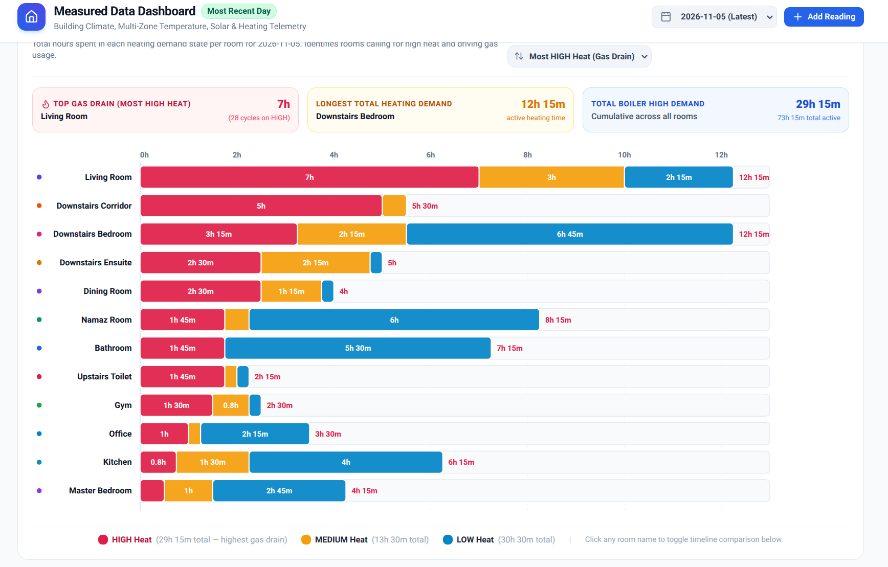

# 🌡️ Tado Multi-Zone Smart Heating Data Sync (Enhanced Analytics)

> **Acknowledgments:** This project is an enhanced, highly-optimized fork inspired by the excellent foundational work of [theotocopulitos/TadoDataSync](https://github.com/theotocopulitos/TadoDataSync). This version has been heavily re-architected with enterprise-grade batch processing to bypass Google Sheets timeouts, in-memory deduplication, strict error validation, and seamless integration with Octopus Energy tariffs.

This project allows you to automatically capture every temperature change, boiler request, and weather fluctuation directly into a Google Sheet.

## 🔗 Integration with Octopus Energy (Optional)
This project is designed to be the perfect companion to my [OctopusDataSync](https://github.com/Sufyaan-Kazi/OctopusDataSync) script. By running both pipelines into Google Sheets, you can align your 15-minute Tado "Call for Heat" intervals with your 30-minute Octopus electricity and gas costs. This allows you to build powerful BI dashboards (using Looker Studio) to track the exact financial cost of heating individual zones in your home.

---

## ⚠️ CRITICAL: API Limits & Execution Time
If you do **not** have a paid Tado Auto-Assist subscription, Tado imposes a strict limit of **100 API calls per day**.
- **The Strategy:** We use a "Slow-Sync" method (downloading 10–20 days per night) to avoid being banned by Tado.
- **Execution Timeout:** Google Apps Script has a maximum runtime. If you set your historical batch too high (e.g., 100 days), the script will crash before finishing. 
- **Recommendation:** Keep `DAYS_PER_HISTORY_BATCH` between **10 and 30 days**. This is the "sweet spot" for reliability and speed.

---

## 🛠️ Phase 1: Preparation

1. Create a new [Google Sheet](https://sheets.new).
2. Open the Script Editor: **Extensions** > **Apps Script**.
3. Create the files:
   - Rename the default `Code.gs` to `Main.gs` and paste the **Main Script** code.
   - Click the **+** (Plus icon) > **Script**. Name it `Auth.gs` and paste the **Handshake Script** code.
4. **Save:** Click the floppy disk icon in the toolbar.

---

## 🔐 Phase 2: The "Handshake" (Safe Authorization)

Since this is a custom script, Google and Tado will ask for explicit permission. This is a one-time setup.

### Step A: Granting Google Permissions
1. In the top toolbar, select the function `requestAuthorization` and click **Run**.
2. A window titled **"Authorization Required"** will appear. Click **Review Permissions**.
3. Select your Google account.
4. **The "Unverified" Warning:** Because you just created this script, Google will warn you. 
   - Click **Advanced** (bottom left).
   - Click **Go to [Your Project Name] (unsafe)**.
5. Click **Allow**.

### Step B: Connecting to Tado
1. Look at the **Execution Log** at the bottom of the screen.
2. Find the link: `1. OPEN THIS LINK: https://login.tado.com/...`
3. **Copy and open that link** in your browser.
4. Log in to Tado and click **Approve**.
5. Return to the Google Script log. Copy the `device_code` (e.g., `_Xy7...`).

### Step C: Saving the "Master Key" (Refresh Token)
1. In `Auth.gs`, find `DEVICE_CODE` at the top and paste your code from Step B inside the quotes.
2. Select the function `finalizeTokenRequest` in the toolbar and click **Run**.
3. The log will show a **✅
